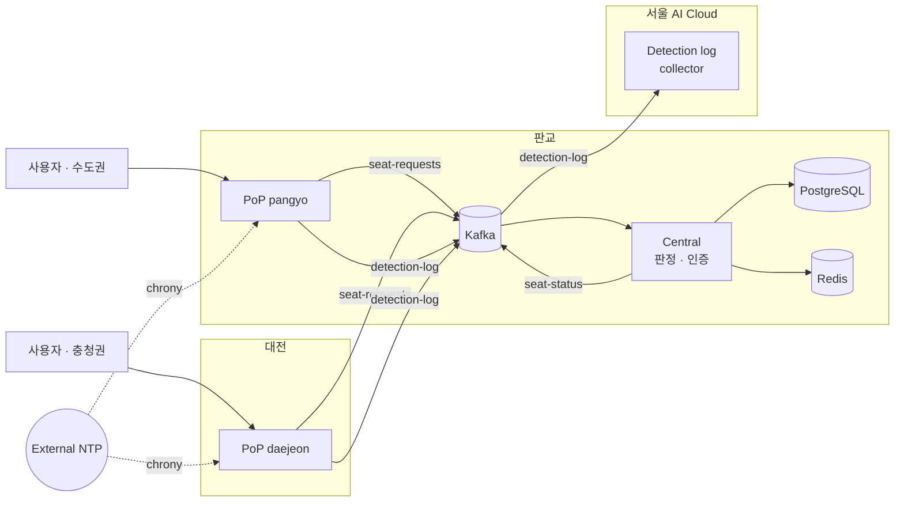

<div align="center">

# DOON

KOREN 전국 PoP 기반 엣지 시각 동기화를 통한 지역 간 네트워크 지연 격차 보정과<br>
AI 매크로 탐지로 구현하는 실시간 공정 티켓팅 플랫폼

K-디지털 챌린지: 넷 챌린지 캠프 시즌13 · Team Doon


</div>

## Overview

중앙 집중형 티켓팅에서는 서버와 물리적으로 가까운 사용자의 요청이 먼저 도착하고, 도착 순서가 곧 예매 순서가 된다.
DOON은 판정 기준을 중앙 서버 도착 시각에서 사용자와 가장 가까운 PoP 도착 시각으로 옮긴다.
각 PoP의 시계 오차는 외부 NTP 기준으로 상시 측정하고, 중앙 판정 서버는 보정된 시각만으로 승자를 정한다.

매크로 대응은 두 단계로 구성된다. PoP에서 요청 빈도와 헤더 정합성으로 1차 필터링하고,
요청 단위 접속·신원 로그를 KOREN 망을 통해 서울 AI Cloud로 수집해 탐지 모델 학습에 사용한다.

## Architecture



| 구성 요소 | 역할 |
|---|---|
| PoP | 요청 도착 시각 기록, 시계 오차 첨부, 토큰 로컬 검증, 1차 봇 필터 |
| Central | 좌석별 수집창(PoP→중앙 지연으로 자동 산정, 시연 구성은 3초 고정), `도착 시각 + 시계 오차` 기준 승자 판정, 확정 기록 |
| Kafka | `seat-requests`, `seat-status`, `detection-log` |
| chrony | 모든 PoP가 동일한 외부 NTP를 기준으로 오차 측정 |
| Seoul AI Cloud | `detection-log` 장기 보관 및 학습 데이터 구성 |

설계 배경과 세부 동작은 [SYSTEM.md](SYSTEM.md)에 정리되어 있다.

## Getting Started

### Requirements

- Docker, Docker Compose v2
- chrony (각 PoP 호스트)

### Run (Pangyo)

```bash
git clone git@github.com:KRjinyoung/doon-fair-ticketing.git
cd doon-fair-ticketing

cp .env.example .env
docker compose -f docker-compose.pangyo.yml up -d --build
```

### Run (Daejeon)

대전은 hirun 프록시를 거쳐야 판교에 닿는다. hirun 셸에서 socat 중계기를 먼저 띄운다.

```bash
~/hirun -c bash
bash scripts/daejeon_relay.sh start
exit

docker compose -f docker-compose.daejeon.yml up -d --build
```

대전 PoP 지표를 판교 Pushgateway로 보내는 루프는 systemd 서비스로 설치한다.

```bash
sudo install -m 755 scripts/push_metrics_loop.sh /usr/local/bin/push-metrics-daejeon.sh
sudo install -m 644 scripts/push-metrics-daejeon.service /etc/systemd/system/
sudo systemctl daemon-reload
sudo systemctl enable --now push-metrics-daejeon
```

### Clock offset collector

PoP가 올라가는 모든 호스트에 설치한다. 설치하지 않으면 해당 PoP는 보정 없이 동작한다.

```bash
sudo install -m 755 scripts/chrony-offset-writer.sh /usr/local/bin/
sudo install -m 644 scripts/pop-clock-offset.service /etc/systemd/system/
sudo systemctl daemon-reload
sudo systemctl enable --now pop-clock-offset
```

### Ports

| Port | Service |
|---|---|
| 13198 | Web (nginx) |
| 10001 | Central API |
| 13092 | Kafka (external) |
| 13090 | Prometheus |
| 13300 | Grafana |

## Scripts

```bash
bash scripts/seed_accounts.sh       # 시연 계정 생성
bash scripts/reset.sh               # 좌석 상태 초기화
bash scripts/imhero_load.sh equiv   # 부하 테스트
bash scripts/cheetah_tunnel.sh      # 서울 AI Cloud Kafka 터널
```

## Project Structure

```
.
├── central/                    # 판정 서버, 인증 서버, 모니터 화면
├── pop/                        # PoP 서버, 1차 봇 필터, 예매 웹
├── seoul/                      # detection-log 수집기 (서울 AI Cloud)
├── nginx/                      # 진입점 라우팅
├── monitoring/                 # Prometheus, Grafana
├── scripts/                    # 운영, 시연, 부하 테스트
├── doonload.py                 # 부하 생성기
├── docker-compose.pangyo.yml
├── docker-compose.daejeon.yml
└── SYSTEM.md                   # 시스템 상세 문서
```

## Team

**Team Doon** · K-디지털 챌린지: 넷 챌린지 캠프 시즌13
