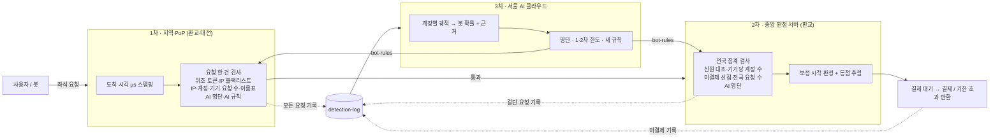

# DOON 매크로 방어 총정리

작성일: 2026-10-16 · 브랜치 `feat/macro-3layer` · 설계 기록: [12-macro-3layer.md](12-macro-3layer.md)

## 한 줄 요약

> **1차(PoP)는 요청 한 건을 규칙으로, 2차(중앙)는 전국 PoP를 모은 지금 상태를 규칙으로, 3차(서울 AI)는 여러 회차에 걸친 계정의 행동을 학습 모델로 본다.**
> 3차는 판정에 끼어들지 않고, 배운 것을 **명단·규칙·한도 값**으로 1·2차에 내려보내 다음부터 앞단에서 바로 막게 한다.

원안 설계는 팀이 국내 봇 방어 기업(에스티씨랩)의 봇매니저와 기술 블로그를 분석해 세웠다. 이 문서는 그 설계를 구현한 결과다.

---

## 1. 전체 구조



| 단계 | 위치 | 보는 범위 | 방식 | 걸리면 |
|---|---|---|---|---|
| 1차 | 지역 PoP | 요청 한 건 + 이 PoP의 최근 요청 | 규칙 | 403(빈도는 429), 판정에 안 들어감 |
| 2차 | 중앙 | 전국 PoP를 합친 지금 상태 + 중앙 DB | 규칙(전국 집계) | 판정 후보에서 빠짐. 남은 요청의 순서·추첨은 그대로 |
| 3차 | 서울 AI | 전국 · 여러 회차 | 학습 모델 | 직접 막지 않음. 명단·규칙·한도를 1·2차로 배포 |

원칙
- **시각이 먼저, 탐지는 자격만.** 탐지는 순서를 바꾸지 않는다. 걸린 요청이 후보에서 빠질 뿐이다.
- **애매하면 통과.** 로그에 없는 값을 가리키는 규칙, 형식이 틀린 규칙 묶음, Redis 장애 시에는 통과시킨다.
- **AI 판단 근거(feature)에 지역·PoP·IP를 쓰지 않는다.** 지방 사용자를 지역 때문에 의심하지 않는다. (1차의 IP 빈도 제한은 일반 웹 방어로 남아 있다.)

---

## 2. 수집하는 데이터

| 시점 | 값 | 어디에 남나 |
|---|---|---|
| 로그인 | 계정 나이 `age`, 브라우저 지문 `dfp`(canvas·WebGL 등으로 만든 기기 식별값), 로그인 IP `lip`, 세션 `sid` | **JWT에 봉인**(이후 변조 불가) + `sessions` 테이블 |
| 좌석 요청마다 | IP, User-Agent, 헤더 순서·값(인증·쿠키 제외), PoP 도착 시각(µs) + JWT 신원 | `seat-requests`(판정용), `detection-log`(탐지용) |
| 판정 이후 | 2차가 뺀 요청과 사유, 결제 기한 초과(미결제) | `detection-log` |

브라우저 지문은 로그인하는 순간 브라우저가 계산해 보낸다. JWT가 막는 것은 로그인 **이후**의 변조다.

---

## 3. 1차 — 지역 PoP (`pop/first_layer.py`, `pop/bot_rules.py`)

싼 검사부터 차례로, 하나라도 걸리면 멈춘다.

| 순서 | 검사 | 걸리는 조건 (기본값) | 사유 코드 |
|---|---|---|---|
| ① | 위조 토큰 | JWT 서명이 맞지 않음 (만료는 위조가 아님) | `forged_token` |
| ② | 차단 목록 | ③에서 걸렸던 IP·계정·기기, 1시간 동안 | `blocked_ip` / `blocked_account` / `blocked_device` |
| ③ | 요청 수 | IP 10초 30회, **계정 10초 20회, 기기 10초 30회** 초과 | `rate_limit` / `rate_limit_account` / `rate_limit_device` |
| ④ | 이름표 | User-Agent가 없거나 `python`·`curl`·`wget`·`go-http`·`java`·`scrapy`·`headless`·`bot` 포함, 또는 `Accept-Language` 없음 | `abnormal_headers` |
| ⑤ | AI 명단 | 3차가 보낸 계정·기기 | `blacklist:account` / `blacklist:device` |
| ⑥ | AI 규칙 | 3차가 보낸 1차 규칙(요청 한 건의 값으로 판단) | `rule:<id>` |

- 계정·기기 기준(②③)과 ⑤⑥은 **좌석 요청에만** 적용한다. 좌석 화면은 결과를 기다리며 0.5초마다 상태를 조회하므로, 조회까지 세면 진짜 사용자가 몇 초 만에 한도를 넘는다.
- ③의 한도와 ④의 단어 목록은 코드에 고정된 값이 아니다. 3차가 규칙 묶음(`params.l1`)으로 바꿀 수 있다.
- 동작 모드 `BOT_FILTER_MODE`: `off` / `monitor`(판정만, 통과) / `enforce`(차단). 실서비스는 현재 `monitor`.
- 검사 시간은 수 µs이고, 도착 시각은 검사 **전에** 찍는다. 검사가 판정 시각에 영향을 주지 않는다.

---

## 4. 2차 — 중앙 판정 서버 (`central/second_layer.py`)

판정 함수(정렬·추첨·Redis Lua) **앞에서** 거른다. 메모리 경로와 Redis 경로가 같은 검사를 받는다. 중앙은 워커 프로세스가 여러 개라 전국 집계 숫자는 Redis에 두고 함께 본다.

| 항목 | 걸리는 조건 (기본값) | 왜 2차인가 | 사유 코드 |
|---|---|---|---|
| ① 신원 대조 | 요청의 세션이 로그인 때 기록된 계정·기기와 다름 | 세션 기록은 중앙 DB만 안다 | `identity_mismatch` |
| ② 기기당 계정 수 | 한 기기 지문에 계정 **3개 초과** + 이 계정이 **가입 7일 미만** (오래된 계정끼리 기기 공유 = PC방·가족 → 제외) | 계정들이 여러 PoP로 흩어져도 놓치지 않으려면 중앙에서 센다 | `device_farm` |
| ③ 미결제 선점 | 결제 기한을 넘겨 좌석을 돌려준 횟수 **2회 초과** | 결제 대기는 중앙에 있다 | `seat_hoarding` |
| ④ 전국 합산 요청 수 | 계정 10초 **30회**, 기기 10초 **40회** 초과 (모든 PoP 합산) | PoP마다 나눠 보내면 1차는 각각 한도 아래로만 본다 | `rate_limit_account_global` / `rate_limit_device_global` |
| ⑤ AI 명단 | 3차가 보낸 계정·기기 | — | `blacklist:*` |
| ⑥ AI 규칙 | 3차가 보낸 2차 규칙(집계 값 `agg.*`도 볼 수 있음) | — | `rule:<id>` |

- 걸린 요청은 판정 후보에서만 빠지고 `detection-log`에 `second_layer_block`으로 남는다. 사용자에게는 "낙첨"으로 보인다.
- 모드 `L2_MODE`: `off` / `monitor`(기본) / `enforce`. 실험판은 `enforce`.

---

## 5. 좌석 선점 방지 — 결제 단계 (`central/seat_hold.py`)

```
창 마감 → 승자 = 결제 대기 (HOLD_SEC 안에 결제, 기본 120초) → 결제(POST /payment) → 결제 완료
                                    └→ 기한 초과 → 좌석 반환(available) + 그 계정 미결제 +1
```
- 결제 대기 중에도 좌석은 다른 사람에게 확정으로 보인다(`paid=false`, `hold_until`).
- 결제는 PoP가 중앙으로 전달하고, 중앙이 "이 좌석을 이긴 요청·계정이 맞나"를 확인한다.
- 만료 하나는 정확히 한 워커만 처리한다(Redis `ZREM` 반환값 = 처리 권한).
- 미결제 횟수는 2차 ③이 읽는다.

---

## 6. 3차 — 서울 AI 클라우드 (`seoul/ai3.py`)

### 6-1. 원재료
`detection-log` 전체(1차 통과 요청, 1차 차단, 2차 차단, 미결제)와 **회차 오픈 시각**. 오픈 시각은 "오픈 후 몇 ms에 도착했나"를 계산하는 데만 쓴다(실서비스에서는 예매 오픈 일정표).

### 6-2. 계정별 feature

| feature | 계산 방법 |
|---|---|
| 회차 간 도착 흩어짐 | 최근 5회차 "오픈 후 첫 도착 시각"의 표준편차 (3회차 이상) |
| 같은 기기 계정 수 | 이 계정의 기기 지문을 쓴 계정 수 |
| 1초 안에 노린 좌석 수 | 한 회차에서 1초 사이에 요청한 서로 다른 좌석 수의 최댓값 |
| 요청 간격 변동계수 | 회차 안 연속 요청 간격의 표준편차 ÷ 평균 (간격 3개 이상) |
| 요청 간격 비대칭도 | 같은 간격 분포가 한쪽으로 꼬리가 긴 정도 |

계정 나이는 아래 "사람" 라벨을 정하는 데 쓰므로 모델에는 넣지 않는다(넣으면 모델이 라벨 정의를 외운다). 계정 나이는 2차가 쓴다.

### 6-3. 라벨 — 정답표 없이 1·2차 판정으로 (약한 지도 학습)

| 라벨 | 조건 |
|---|---|
| 봇 | 1·2차가 **확실한 사유**로 막은 적 있음: 이름표, 위조 토큰, 기기 농장, 미결제 선점, 신원 불일치, 요청 빈도 초과 |
| 사람 | 계정 나이 30일 이상 + 1·2차에 한 번도 안 걸림 + 2회차 이상 참여 |
| 없음 | 나머지 → 모델이 확률을 매긴다 |

AI 명단·AI 규칙으로 막힌 기록은 라벨로 쓰지 않는다(AI가 스스로를 강화하는 고리를 막는다).

### 6-4. 학습 · 판정 · 근거
- 회차가 끝날 때마다(미결제 기록이 들어올 25초 뒤) 전체 기록으로 다시 학습한다.
- 그래디언트 부스팅 모델 → **모든 계정의 봇 확률**.
- 근거: 전체 feature 중요도(permutation importance) + 계정마다 사람 범위에서 가장 벗어난 feature 3개.
  예: `회차 간 도착 흩어짐 0.31ms (사람 중앙 708ms)` → 봇 확률 1.0

### 6-5. 출력 (Kafka `bot-rules`, 한 버전 = 한 메시지)

| 출력 | 기준 | 받는 곳 |
|---|---|---|
| 계정 명단 | 봇 확률 ≥ 0.9 (믿을 만한 사람 제외) | 1차 ⑤, 2차 ⑤ |
| 기기 명단 | 명단 계정이 쓴 기기 중 믿을 만한 사람이 쓴 적 없는 것 | 1차 ⑤, 2차 ⑤ |
| 한도 값 | §7 정교화 | 1차 ③, 2차 ②③④ |
| 새 규칙 | §7 정교화 | 1차 ⑥ |

---

## 7. 1·2차 규칙 정교화 (3차가 돌림)

1. **기록**: 1·2차는 요청마다 걸린 규칙(그림자 포함)과 규칙 버전을 남긴다.
2. **채점**: 3차의 봇 확률을 기준으로 규칙마다 잡은 봇 / 걸린 믿을 만한 사람을 센다.
3. **한도 재계산**: 10초 최대 요청 수(1차는 PoP별, 2차는 전국), 기기당 계정 수, 미결제 횟수를 봇과 사람끼리 비교해, **사람은 한 명도 안 걸리는 선까지만** 조인다. 조여서 새로 잡히는 봇이 있을 때만 바꾼다. 요청 수 한도는 최소 5, 사람 최댓값의 2배 이상으로 넉넉히 둔다.
4. **새 규칙 후보**: 봇 2개 계정 이상이 쓰고 사람은 안 쓰는 **헤더 순서**, **User-Agent 조각** → 사람 기록에 다시 돌려 보고(재실행) 한 건이라도 맞으면 버린다.
5. **그림자 배포**: 새 규칙은 `shadow`로 나가 막지 않고 "막았을 것"만 기록한다.
6. **승격·폐기**: 그림자 기간(2회차 이상)에 봇만 2건 이상 맞히면 `enforce`로 승격, 사람을 한 건이라도 맞히면 폐기.
7. **비상 정지**: 빈 규칙 묶음을 새 버전으로 발행하면 기본 한도 + v0 규칙만 남는다.

고정 기준점: 믿을 만한 사람이 한 명이라도 걸리는 제안은 버린다(1·2차 → 3차 → 1·2차 고리가 폭주하지 않게).

### 규칙 묶음 형식
```json
{"version": "v3-ai3-r4", "approved_by": "ai3-auto-check", "approved_at": "...",
 "params": {"l1": {"rate": {"ip": [10, 30], "account": [10, 20], "device": [10, 30]},
                   "ua_tokens": ["python", "curl", "..."], "block_ttl_sec": 3600},
            "l2": {"rate": {"account": [10, 30], "device": [10, 40]},
                   "device_accounts": {"max": 3, "young_days": 7}, "hold": {"max_unpaid": 2}}},
 "blacklist": {"accounts": ["acc-..."], "devices": ["..."]},
 "rules": [{"id": "hdr-4ccf8f", "layer": 1, "mode": "enforce", "why": "봇 5개 계정만 쓰는 헤더 순서",
            "all": [{"f": "headers.order", "op": "eq", "v": ["..."]}], "since_round": 2}]}
```

---

## 8. 실험 봇 6종과 방어

| 봇 | 어떻게 움직이나 | 실제 매크로 유형 | 막는 곳 · 근거 |
|---|---|---|---|
| ① 단순 | 스크립트로 좌석 API 직접 호출, 이름표 `Python-urllib` | 초보 매크로 | **1차** 이름표 검사, 첫 요청부터 |
| ② 농장 | 브라우저 이름표 위장, 프록시로 IP 변경, **기기 하나에서 갓 만든 계정 여러 개** | 다계정 조직 | **2차** 기기당 계정 수 → 이후 **기기째** AI 명단, 같은 기기의 새 계정도 막힘 |
| ③ 선점 | 오픈 순간 좌석 3개를 잡고 **결제 안 함**, 기기 지문·IP 변경 | 좌석·장바구니 선점 | 결제 기한 초과 반환이 3회 쌓이면 **2차** 미결제 검사 |
| ④ 위장 | 크롬 이름표 + 한국어 헤더, 로그인마다 **기기 지문 새로 생성**(안티디텍트), IP 변경, 결제함 | 헤더 위장 API 매크로 | 1·2차 통과 → **3차**(흩어짐 0.3~1ms) 명단 → 다음 회차부터 1·2차 차단 |
| ⑤ 반복 | ④ + 좌석 4개를 0.3~1.2초 무작위 간격으로 시도 | 반복 요청 매크로 | **3차** 명단 |
| ⑥ 스텔스 | **진짜 크롬** + 자동화 흔적을 지우는 스텔스 플러그인, 헤더가 진짜 브라우저와 같음, IP 변경, 결제함 | 사람 흉내 고급 매크로 | **2차** 기기 공유(같은 실행 환경이라 기기 지문이 같음) → **3차** 명단(흩어짐 4~7.5ms) |

처음 보는 봇 계정: 3차가 만든 "봇 전용 헤더 순서" 규칙(1차)과 기기 명단으로 **첫 요청부터** 막힌다.

---

## 9. 실험 결과 (격리 실험판, 2026-10-16, 18회차)

봇 6종 × 2개, 사람 시뮬레이터 40명(당첨되면 97% 결제). 1~14회차는 같은 봇 계정 12개, 15~18회차는 **처음 보는 봇 계정 12개**. 결제 기한은 실험판에서 20초.

| 회차 | 단순 | 농장 | 선점 | 위장 | 반복 | 스텔스 | 사람 (판정까지 간 요청) |
|---|---|---|---|---|---|---|---|
| 1 | 1차 | 2차 | 통과 | 통과 | 통과 | 2차 | 39/39 |
| 2 | 1차 | 2차 | 2차 (미결제 3회) | 통과 | 통과 | 2차 | 36/36 |
| 3 | 1차 | 3차 명단 | 3차 명단 | 통과 | 절반 3차 명단 | 3차 명단 | 30/30 |
| 4~14 | 1차 | 3차 명단 | 3차 명단 | 3차 명단 | 3차 명단 | 3차 명단 | 전원 통과 |
| 15 (새 계정) | 1차 | 3차 명단 (기기) | **1차 (AI 규칙)** | **1차 (AI 규칙)** | **1차 (AI 규칙)** | 3차 명단 (기기) | 40/40 |
| 16~18 | 1차 | 3차 명단 | 3차 명단 | 3차 명단 | 3차 명단 | 3차 명단 | 전원 통과 |

- **사람 요청은 18회차 동안 한 건도 막히지 않았다.**
- 3차 라벨(18회차 끝): 봇 10개 계정(단순 4·농장 2·선점 2·스텔스 2), 사람 40개 계정, 라벨 없음 14개 계정.
- 3차 feature 중앙값: 회차 간 도착 흩어짐 사람 527ms / 위장 봇 0.7ms / 스텔스 봇 5.7ms, 같은 기기 계정 수 사람 1 / 농장 봇 8, 1초 안 좌석 수 사람 1 / 선점 봇 3.
- 모델 중요도는 회차 간 도착 흩어짐이 가장 컸다(0.29, 나머지는 0 — 흩어짐 하나로 완전히 갈렸다).
- 정교화: 2회차에 "봇만 쓰는 헤더 순서" 규칙 2개가 그림자로 나갔고, 그중 하나가 봇만 6건 맞혀 4회차에 enforce로 승격했다. 15회차 새 계정의 선점·위장·반복 봇을 첫 요청에서 막은 것이 이 규칙이다.
- 3차 재학습·배포는 회차마다 0.2초 안팎.

다시 뽑기: `python3 sim/layer_report.py sim/rounds3l2.jsonl <detection-log 덤프>`

### 9-2. 약한 라벨 검증 (정답은 채점에만 사용)

`python sim/eval_labels.py sim/rounds3l2.jsonl <detection-log>` — 학습에는 정답을 쓰지 않고, 끝난 뒤 채점만 했다.

| 항목 | 결과 |
|---|---|
| '봇' 라벨 정확도 | 10개 중 10개 진짜 봇 (100%) |
| '사람' 라벨 정확도 | 40개 중 40개 진짜 사람 (100%) |
| 봇 라벨 확보율 | 봇 24개 중 10개 (42%) — 나머지는 1·2차가 확실한 사유로 막지 못했거나 AI 명단에 먼저 막혔다 |
| 모델 최종 판단 | 봇 24/24, 그중 라벨 없던 14개도 탐지. 사람 오탐 0/40 (단, 이 40명은 학습에도 쓰였다) |

라벨을 일부러 틀리게 바꿔 다시 학습 (10번 평균)

| 오염 | 봇 탐지 (24개 중) | 사람 오탐 (40명 중) |
|---|---|---|
| 사람 라벨 10% → 봇 | 24.0 | 3.8 |
| 사람 라벨 20% → 봇 | 24.0 | 7.3 |
| 봇 라벨 30% → 사람 | 14.5 | 0 |
| 둘 다 20% | 17.0 | 7.3 |

사람을 봇으로 잘못 적으면 틀린 수만큼 오탐이 생기고, 봇을 사람으로 잘못 적으면 탐지율이 크게 떨어진다. '사람' 라벨은 엄격하게 골라야 한다.

### 9-3. 처음 보는 공격 (2026-10-16, 8회차)

학습 기간(9절 18회차)이 끝난 뒤 3차 자동 반영을 멈추고, 마지막 규칙 묶음(`v17-ai3-r18`)과 모델을 **얼렸다.**
평가 회차는 규칙 묶음을 비운 채(1·2차 기본 규칙만) 돌렸으므로 평가 데이터는 학습·규칙 생성에 들어가지 않았다.
새 봇 계정 12개(bot25~36), 사람 보통 40명 + **0초에 80~120ms 간격으로 연타하는 고수 20명**.
`python sim/eval_attacks.py <학습 회차> <학습 로그> <얼린 규칙> <평가 회차> <평가 로그>`

| 공격 | ① 1·2차 규칙만 | ② 시간만 보는 AI (연속 5회 흩어짐 ≤ 12.6ms) | ③ 3단계 전체 (얼린 AI) | ③에서 잡은 곳 |
|---|---|---|---|---|
| A: 위장 봇 + 발사 시각 0~50/100ms 무작위 지연 | 0/4 | 0/4 | **4/4** | AI가 만든 헤더 규칙 3, 3차 모델 1 |
| B: A + 진짜 크롬과 같은 헤더 순서·값 | 0/4 | 3/4 | 3/4 | 3차 모델 |
| C: 진짜 크롬(스텔스) + 시간 지연 + 기기 지문 흔들기 | 0/4 | 3/4 | 4/4 | 3차 모델 |
| 사람(고수) 오탐 | 0/20 | 1/20 | **10/20** | 3차 모델 |
| 사람(보통) 오탐 | 0/40 | 0/40 | 0/40 | |

회차 간 도착 흩어짐: 지연 봇 8~39ms, 고수 사람 7.7~48.5ms (완전히 겹침), 보통 사람 54ms~2.3초.
지연 봇의 첫 도착 중앙값은 27~95ms로, **사람의 88~92%보다 빠르다.**

해석
- **AI가 만든 규칙의 기여:** 같은 도구로 만든 봇(A)은 시간을 흔들고 계정을 바꿔도, 예전 봇에서 배운 헤더 규칙에 **첫 요청부터** 걸렸다. 1·2차 고정 규칙만으로는 0/4였다.
- **시간 신호의 한계:** B·C를 잡은 것은 3차 모델의 시간 신호다. 모델의 경계가 예전 규칙(12.6ms)보다 느슨해 지연 봇을 잡았지만, 고수 사람 절반도 같이 걸었다. 흩어짐이 완전히 겹치므로 시간만으로는 둘을 가를 수 없다.
- **해결하지 못한 공격:** 시간·헤더·기기를 모두 위장하면서 사람의 약 90%보다 빠른 봇. 시간 신호만 남은 의심 계정은 차단하지 말고 추가 인증(캡차 등)으로 넘겨야 한다.
- 실제 배포 로직은 '믿을 만한 사람'(오래된 무사고 계정)을 명단에서 빼므로 이 고수 10명은 실제로는 막히지 않았을 것이다. 다만 실험판에서는 계정 나이가 사람과 봇을 가르도록 심어 둔 값이라, 이것을 해결의 근거로 삼지 않는다.

---

## 10. 구현 중 고친 것

| 문제 | 고친 것 |
|---|---|
| 계정·기기별 요청 수 제한이 좌석 상태 조회까지 세서 사람 35명을 막음 | 좌석 요청에만 적용 |
| 3차가 '사람' 라벨 정의(계정 나이)와 같은 계정 나이를 feature로 써서 라벨을 외움 | 3차 모델에서 계정 나이 제외 |
| 정교화가 요청 한도를 3까지 조임 | 최소 5, 사람 최댓값의 2배 |
| PoP가 `available`(초기화·반환된 좌석) 상태 조회에서 500 오류 | 열린 좌석으로 응답. **실서비스에도 있는 버그**라 반영 시 함께 고쳐진다 |
| 결제 경로가 nginx에서 막힘(405) | nginx 설정에 `/payment` 추가 |

---

## 11. 범위 밖 (다음 과제)

- 고객 계정으로 대신 예매하는 대리 예매(계정마다 1~2번이라 회차 궤적이 안 쌓인다)
- 매번 수십 ms 이상 무작위 지연을 섞는 봇(흩어짐이 사람 쪽으로 간다)
- 오래된 계정을 사서 쓰면서 기기 지문까지 바꾸는 봇
- 사람은 시뮬레이터, 봇 계정 나이·기기 공유는 실험판에 심어 둔 값

---

## 12. 파일

| 파일 | 역할 |
|---|---|
| `pop/first_layer.py` | 1차 검사(위조 토큰, 차단 목록, IP·계정·기기 요청 수, 이름표), 한도 값 교체 |
| `pop/bot_rules.py` (= `central/bot_rules.py` 복사본) | 규칙 묶음 형식 검사, 명단·규칙 판정(enforce/shadow, layer 1/2) |
| `pop/pop_server.py` | 1차 연결, 규칙 묶음 구독, `/payment` 전달 |
| `pop/pop_auth.py`, `central/central_server.py` | JWT 봉인(`lip` 추가), 2차·결제 연결 |
| `central/second_layer.py` | 2차 검사(Redis 공유) |
| `central/seat_hold.py` | 결제 대기·결제·기한 초과 반환 |
| `seoul/ai3.py` | 3차: feature·라벨·모델·근거, 명단·한도·규칙 정교화, 배포 |
| `bots/script_bot.py`, `bots/browser_bot.js`, `bots/rounds.py` | 실험 봇 6종, 회차 진행기 |
| `sim/humans.py` | 사람 시뮬레이터(당첨 시 결제) |
| `sim/layer_report.py` | 회차별 봇 종류마다 막힌 단계 표 |
| `nginx/default.conf`, `nginx/daejeon.conf` | `/payment` 경로 |

## 13. 재현과 실서비스 반영

실험판(판교, 이 브랜치의 작업 폴더에서)
```bash
SIM_FILTER_MODE=enforce docker compose -p doonsim -f sim/docker-compose.yml up -d --build
docker run -d --name doonsim-ai3 --network doonsim_default -v "$PWD":/repo doon-ai3 \
  python -u seoul/ai3.py --rounds sim/rounds3l2.jsonl --bootstrap kafka:9092 --log sim/out/ai3.jsonl
python3 bots/rounds.py --base http://172.17.0.1:18198,http://172.17.0.1:18199 --every 1 --rounds 14 \
  --copies 2 --humans 40 --types simple,farm,hoarder,disguised,poller,stealth \
  --bot-from 1 --bot-count 12 --out sim/rounds3l2.jsonl --yes
```
(`doon-ai3` = python:3.11-slim + scikit-learn + kafka-python)

실서비스 반영(사람이 실행)
- 판교: 이 브랜치를 받은 뒤 `docker compose -f docker-compose.pangyo.yml up -d --build central pop-pangyo && docker restart nginx`
- 대전: `git pull` 후 `docker compose -f docker-compose.daejeon.yml up -d --build && docker restart nginx`
- 1차(`BOT_FILTER_MODE`)와 2차(`L2_MODE`) 모두 기본값은 `monitor`(판정만, 통과)다. 실험판만 `enforce`. 결제 기한 기본 120초.
- 3차를 진짜 서울(Cheetah)에서 돌리려면 SSH 터널을 연 뒤 `TUNNEL_HOST=127.0.0.1 KAFKA_BOOTSTRAP=kafka-external:13092 python3.11 ai3.py --rounds <오픈 일정>`.
